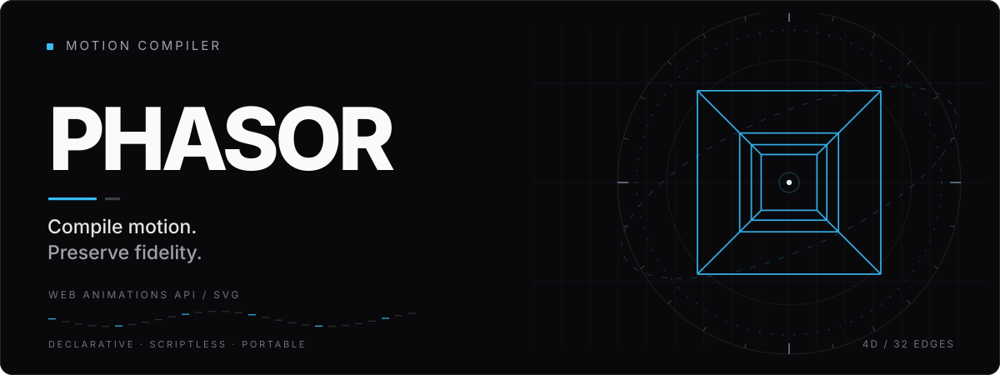

<p align="center">
  
</p>

<p align="center">
  <a href="https://github.com/thelabcorner/Phasor/actions/workflows/ci.yml"></a>
  <a href="LICENSE"></a>
  
  
</p>

<p align="center">
  <strong>A compiler for motion, not a frame recorder.</strong><br/>
  Convert Web Animations API keyframes into self-contained, scriptless SVG animation.
</p>

<p align="center">
  <a href="#quick-start">Quick start</a> ·
  <a href="#why-phasor">Why Phasor</a> ·
  <a href="#supported-surface">Compatibility</a> ·
  <a href="#fidelity--evidence">Fidelity</a> ·
  <a href="#architecture">Architecture</a>
</p>

---

## Why Phasor

Web Animations API (WAAPI) is powerful in a browser, but its effects ordinarily depend on a running document and animation timeline. Phasor translates supported effects into the native declarative primitives of SVG: `<animate>` and `<animateTransform>`. The resulting image can play inside an `` element without bundling an animation runtime.

Phasor does not screenshot each frame. It preserves original keyframes and easing when SVG can represent them, constructs mathematically equivalent cycles for eligible direction modes, and refuses conversions it cannot substantiate. An independent procedural module handles higher-dimensional geometry.

| | Phasor's approach |
|:--|:--|
| **Native motion** | Linear and cubic Bézier keyframes map to SVG animation primitives without baking frames. |
| **Temporal fidelity** | Delays, repeats, direction, and fill are normalized with explicit boundary rules. |
| **Real source capture** | An opt-in adapter reads a restricted set of native `Animation` and `KeyframeEffect` objects. |
| **Zero playback JavaScript** | Motion lives inside the SVG. No `<script>`, `requestAnimationFrame`, or animation runtime. |
| **Proof-oriented compilation** | Unsupported effects produce typed diagnostics, not silent approximations. |

## Quick start

Phasor is currently **source-distributed**. No npm release has been published.

```bash
git clone https://github.com/thelabcorner/Phasor.git
cd Phasor
npm ci
npm run build
npm test
npm run example
```

The last command writes `examples/animated-circle.svg`.

### Compile an animation

```ts
import { compileSvgAnimation } from "./dist/index.js";

const { svg, report } = compileSvgAnimation({
  svg: '<svg xmlns="http://www.w3.org/2000/svg" viewBox="0 0 120 80"><circle id="orb" cx="16" cy="40" r="10" fill="#38bdf8"/></svg>',
  tracks: [{
    target: { svgId: "orb" },
    keyframes: [
      { offset: 0, cx: 16, easing: "ease-in-out" },
      { offset: 1, cx: 104 },
    ],
    timing: {
      duration: 1200,
      iterations: Infinity,
      direction: "alternate",
    },
  }],
  options: { mode: "exact-only", profile: "svg-image" },
});

console.log(report);
```

For eligible motion, the compiler emits native SVG animation, such as:

```xml
<animate
  attributeName="cx"
  dur="2.4s"
  repeatCount="indefinite"
  calcMode="spline"
  keyTimes="0;0.5;1"
  values="16;104;16"
  keySplines="0.42 0 0.58 1;0.42 0 0.58 1"
/>
```

Alternating movement is represented as a two-pass SVG cycle. No timer, canvas capture, or embedded script is needed.

### Capture browser-native WAAPI effects

```ts
import { captureWaapiAnimations } from "./dist/browser/capture.js";
import { compileSvgAnimation } from "./dist/index.js";

const circle = document.querySelector<SVGCircleElement>("#orb")!;
const root = circle.ownerSVGElement!;
const animation = circle.animate(
  [{ opacity: 1, easing: "ease-in-out" }, { opacity: 0.2 }],
  { duration: 1400, iterations: 2, fill: "forwards" },
);

animation.pause();
await animation.ready;

const request = captureWaapiAnimations(root, [animation]);
const result = compileSvgAnimation(request);
```

Capture currently accepts restricted opacity channels and single-function SVG transforms with explicit underlying attributes. It does not snapshot the current playhead, reconstruct arbitrary computed CSS, or capture HTML.

## Built with Phasor

**The rotating tesseract in the header is real Phasor output.** It is not a prerecorded video, GIF, or JavaScript animation. A 4D hypercube with 16 shared vertices and 32 edges is projected to 2D; one SVG `<path>` animates through geometry-compatible frames with a closed temporal seam.

<p align="center">
  <a href="examples/animated-tesseract.svg"><strong>Open the standalone animated tesseract →</strong></a>
</p>

The independent procedural module can generate similar output:

```ts
import { compileTesseractSvg } from "./dist/procedural/tesseract.js";

const { svg, report } = compileTesseractSvg({
  periodMs: 4000,
  tolerancePx: 0.3,
  maxKeyframes: 2048,
});
```

The generator compares adaptive and uniform time lattices against a **sampled** geometry budget, then chooses the smaller eligible SVG. Reported error is empirical, not a certified continuous-time bound. The procedural exporter is separate from WAAPI lowering.

## Supported surface

| Capability | Current status |
|:--|:--|
| Numeric SVG geometry and opacity attributes | Eligible with explicit numeric baselines |
| Keyframe offsets and outgoing keyframe easing | Eligible; duplicate/discontinuous offsets currently refuse |
| Linear and compatible cubic Bézier easing | Native lowering candidates |
| Single-function `translate(px)`, `scale()`, `rotate(deg)` | Native `<animateTransform>` candidates |
| Normal, reverse, alternate, alternate-reverse | Eligible finite-integer and infinite iterations |
| Positive delay; negative delay with active time remaining after t=0 | Eligible |
| `fill: none` and `fill: forwards` | Supported |
| CSS transform stacks, origin/box overrides, 3D CSS matrices | Not yet lowered |
| Overlapping same-property effects, add/accumulate composition | Not yet lowered |
| Stylesheet cascades and implicit inherited baselines | Not yet resolved |
| Springs, steps, overshooting Béziers, fractional authored iterations | Not yet lowered |
| Standalone procedural tesseract animation | Experimental extension |

The report's `status: "exact"` means **structurally eligible under stated preconditions**, not a certification of universal cross-browser pixel perfection. Phasor is experimental research software, and its conservative SVG restrictions are not a complete sanitizer for arbitrary uploaded documents.

## Fidelity & evidence

Measurements and original failed controls are checked into the repository. No unmeasured performance claims are required to evaluate the implementation.

| Campaign | Observed result | Source |
|:--|:--|:--|
| Seeded Chromium WAAPI vs SVG | **80 fixtures, 1,425 probes**, maximum observed position deviation **0.00592 px** | [Scalar differential](evidence/chromium-seeded-differential-0002.json) |
| Native transform lowering | 10 fixtures, maximum observed geometry deviation **0.000704 px** | [Transform differential](evidence/chromium-transform-differential-0001.json) |
| Browser-captured transforms | Native translation, scaling, rotation; 12 timeline samples each | [Capture differential](evidence/chromium-native-transform-capture-0001.json) |
| Tesseract, 0.3 px sampled tolerance | **73 keyframes, 77,883 bytes**, 4,001 sampled positions, maximum residual **0.292 px** | [Geometry comparison](evidence/tesseract-pareto-optimized-0003.json) |
| Boundary stress control | **6 unresolved discrepancies** at sub-millisecond finite-repeat boundaries | [Original failing corpus](evidence/chromium-seeded-differential-0001.json) |

The revised scalar corpus retains exact boundaries but probes adjacent positions at least 1 ms away. It does **not** eliminate the original six failures. These results are Chromium-specific observations, not independent Firefox/WebKit certification.

Reproduce using `npm run test:chromium`, `npm run test:directions`, `npm run test:transforms`, `npm run test:capture`, and `npm run test:tesseract`. Browser harnesses currently target an installed Windows Chrome binary. GitHub Actions runs the portable unit/typecheck suite. Both favorable and unfavorable throughput experiments, including distinct-keyframe-object workloads, live under [`evidence/`](evidence/).

## Architecture

```text
SVG document + WAAPI keyframes / captured KeyframeEffect
                           |
                           v
               Validate source / target
                           |
                           v
         Normalize timing, easing, keyframes
                           |
                           v
        Proof-directed lowering or refusal
                           |
                +----------+----------+
                |                     |
                v                     v
           <animate>          <animateTransform>
                |                     |
                +----------+----------+
                           |
                           v
             Self-contained animated SVG
```

The main compiler has no browser dependency. Native browser capture is isolated under `./browser`; the 4D geometry exporter under `./procedural`.

For mechanisms, proofs, and known limitations, read the [architecture RFC](docs/ARCHITECTURE_RFC_0001.md), [compatibility matrix](docs/COMPATIBILITY_PROOF_MATRIX_0001.md), [adversarial corpus](docs/ADVERSARIAL_CORPUS_0001.md), and [engineering status](docs/IMPLEMENTATION_STATUS_0003.md).

## Contributing

Contributions are welcome, especially independent browser-conformance tests, semantics-preserving optimizations, effect-stack correctness, and reproducible benchmark analysis. See [CONTRIBUTING.md](CONTRIBUTING.md). Preserve failing cases as evidence instead of weakening the test oracle.

## License

Phasor is open source under the [MIT License](LICENSE). Copyright © 2026 Jackson Cummings.
